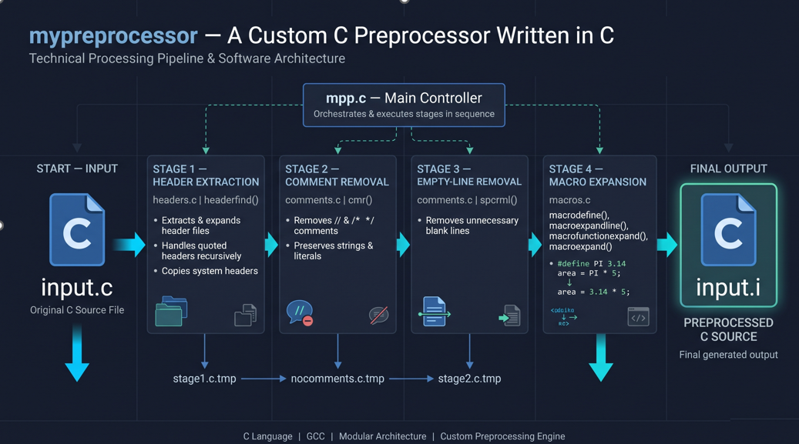
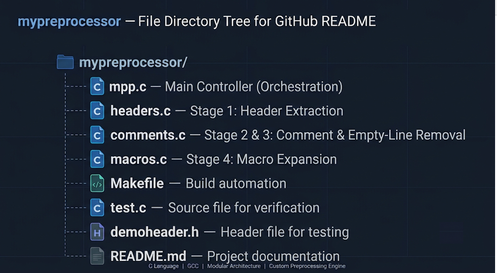
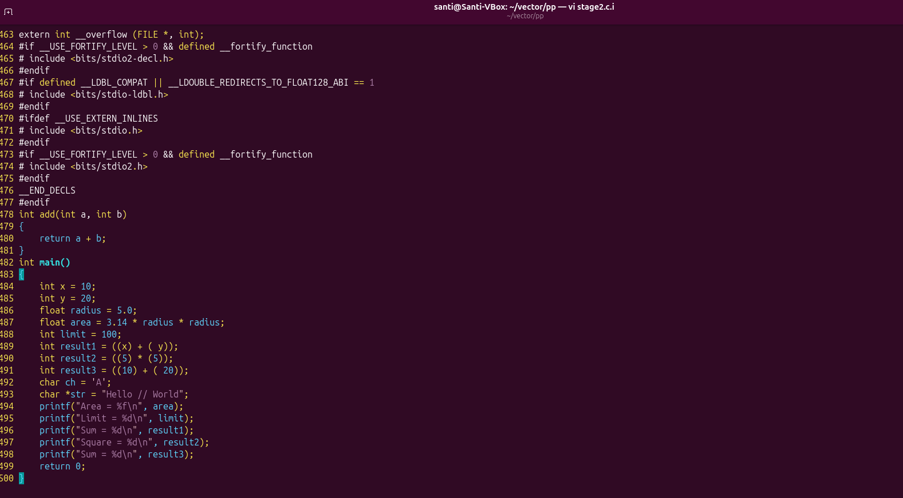

# mypreprocessor

### A Custom C Preprocessor Written in C

`mypreprocessor` is a personal project where I built a simplified version of the C preprocessing stage from scratch using C.

The idea behind this project was to understand what happens to a C source file before it reaches the compiler. Instead of relying on an existing preprocessor, I implemented the major preprocessing operations myself using C file handling, pointers, string manipulation, structures, recursion and modular programming.

The program takes a `.c` source file as input, processes it through multiple stages and generates a preprocessed `.i` file.

---

## Pipeline Architecture

The preprocessor is divided into four processing stages, coordinated by a main controller.



---

## How It Works

The program follows a sequential processing approach.

### 1. Header Extraction

**File:** `headers.c`

Identifies `#include` directives and extracts the corresponding header contents.

- Handles quoted header files (`"header.h"`).
- Supports recursive processing of nested quoted headers.
- Handles angle-bracket system headers through direct content copying.

### 2. Comment Removal

**File:** `comments.c`

Removes comments from the source code.

- Removes single-line comments (`//`).
- Removes multiline comments (`/* ... */`).
- Preserves comment-like characters inside strings and character literals.

### 3. Empty-Line Removal

**File:** `comments.c`

Removes unnecessary blank lines left after comment removal, keeping the intermediate source file cleaner.

### 4. Macro Expansion

**File:** `macros.c`

Processes macro definitions and expands them wherever they are used in the source code.

- Object-like macros.
- Function-like macros.
- Multiline macro definitions.
- Macro storage and lookup using a macro table.

The macro processor performs textual substitution. It does not evaluate expressions.

---

## Project Structure

The project is organised into separate source files, with each file responsible for a particular part of preprocessing.



| File | Responsibility |
|---|---|
| `mpp.c` | Main controller and execution flow |
| `headers.c` | Header extraction |
| `comments.c` | Comment and empty-line removal |
| `macros.c` | Macro definition and expansion |
| `Makefile` | Compilation and build management |

---

## Implementation Highlights

Some of the concepts I worked with while building this project:

- File handling using `fopen()`, `fclose()`, `fgetc()`, `fgets()`, `fputs()` and other file operations.
- String manipulation and character-level parsing.
- Pointer handling and character arrays.
- Structures for storing macro information.
- Recursive function calls for nested header extraction.
- State tracking for handling strings, character literals and comments.
- Modular programming and multi-file compilation.
- Makefile-based build automation.

---

## Code Walkthrough

### 1. Header Extraction and Processing


---

## Execution

The project uses a Makefile to compile the source files.

**Build:**

```bash
make
```

**Run:**

```bash
./exe test.c
```

The program processes the input file through all four stages and generates the final `.i` file.

---

## Sample Output

### 1. Input Source File


### 2. Preprocessed Output



The generated `.i` file contains the processed source code after header extraction, comment removal, empty-line removal and macro expansion.

Intermediate files are cleaned up after successful execution.

---

## Current Scope

The project currently focuses on the fundamental preprocessing operations:

- Header extraction.
- Comment removal.
- Empty-line removal.
- Object-like macro expansion.
- Function-like macro expansion.
- Multiline macro definitions.

This is an educational implementation of a C preprocessor, not a complete replacement for GCC's preprocessor. Features such as conditional compilation (`#ifdef`, `#ifndef`, `#if`), `#undef`, stringification and token pasting are outside the current implementation.

---

## What I Learned

Building this project gave me a much better understanding of how C source code is processed before compilation.

More importantly, it pushed me to work with file operations, pointers, recursion, parsing logic and structures in a practical way rather than learning them as isolated concepts.

There is still room to extend the implementation, but getting the complete processing pipeline working was the main goal of this project.

---

**Built with C | GCC | Makefile**